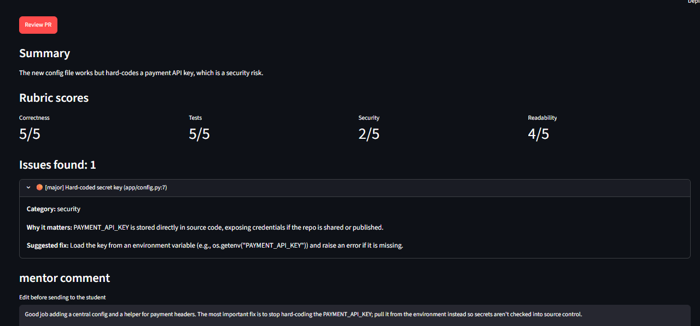

# AI PR Review Assistant

An AI first-pass pull request reviewer for mentorship programs such as Cynbit's **BitElevate**. It reads a PR diff and drafts structured feedback (issues, severity, suggested fixes, rubric scores and a friendly mentor comment), so a human mentor can start from a draft instead of a blank page.

Built for the **Cynbit Technologies AI/ML Engineer Intern assessment: "Identify an AI Opportunity for Cynbit"**.



## Why this exists

BitElevate students submit a PR every day for 60 days, and senior mentors review each one line by line. That does not scale with enrollment. This tool does the repetitive first pass (secrets in code, missing tests, missing indexes, injection risks), and the mentor approves or edits every comment before the student sees it.

## Features

- Paste a PR diff or load one of six sample diffs
- Structured review: summary, issues (file, line, severity, category, explanation, fix), four rubric scores and a draft mentor comment
- Editable mentor comment (human-in-the-loop)
- Output validated with Pydantic, with automatic retry when the model returns malformed JSON
- Evaluation script that measures how many planted flaws the reviewer catches

## How it works

```
PR diff -> truncate long diffs -> mentor-style prompt -> LLM (Groq, JSON mode)
        -> Pydantic validation (retry on failure) -> ReviewResult -> Streamlit UI
```

- **Model:** `openai/gpt-oss-120b` on Groq (set with `GROQ_MODEL`)
- **Framework:** LangChain `ChatGroq`
- **Validation:** Pydantic models with strict allowed values for severity and category

## Tech stack

Python, Streamlit, Groq, LangChain, Pydantic, pytest

## Project structure

```
.
├── app.py                    # Streamlit UI
├── reviewer/
│   ├── core.py               # review_diff(): call model, validate, retry
│   ├── prompt.py             # system prompt
│   └── schemas.py            # Pydantic models
├── scripts/
│   ├── run_one.py            # review a single diff from the command line
│   └── evaluate.py           # evaluation against planted flaws
├── data/
│   ├── sample_diffs/         # 5 diffs with one planted flaw each, plus 1 clean PR
│   └── expected_issues.json  # answer key for evaluation
├── tests/                    # pytest checks for data and schema
├── reports/                  # opportunity report, technical approach report, eval results
├── docs/screenshot.png
├── pytest.ini
├── requirements.txt
└── .env.example
```

## Setup

You need Python 3.10 or newer and a free [Groq API key](https://console.groq.com).

```bash
git clone <your-repo-url>
cd cynbit-pr-review-assistant

python -m venv .venv

# Windows PowerShell
.venv\Scripts\Activate.ps1
# macOS / Linux
source .venv/bin/activate

pip install -r requirements.txt
```

Create your environment file:

```bash
# Windows
copy .env.example .env
# macOS / Linux
cp .env.example .env
```

Open `.env` and set your key. Never commit this file.

```
GROQ_API_KEY=your_groq_api_key_here
GROQ_MODEL=openai/gpt-oss-120b
```

## Usage

**Run the web app**

```bash
streamlit run app.py
```

Pick a sample diff (or paste your own) and click **Review PR**.

**Review one diff from the command line**

```bash
python -m scripts.run_one data/sample_diffs/01_hardcoded_secret.diff
```

**Run the evaluation**

```bash
python -m scripts.evaluate
```

**Run the tests**

```bash
pytest -v
```

## Evaluation

The evaluation set has 6 synthetic diffs: 5 with one planted flaw each (hardcoded secret, missing database index, JWT signature not verified, missing tests, SQL injection) and 1 clean PR. A flaw counts as caught when the model reports an issue with the matching category and an expected keyword. Critical or major issues on the clean PR count as false alarms.

| Run | Recall | False alarms on clean PR | Missed |
|---|---|---|---|
| 1 | 4/5 (0.80) | 0 | missing tests |
| 2 | 4/5 (0.80) | 0 | missing index |

Every planted flaw was caught in at least one run, but the missed flaw changed between runs, so single runs are noisy. See the technical report for the planned fix (multiple runs with merged results) and other limitations.

## Reports

- [AI Opportunity Report]: analysis of AI/ML opportunities for Cynbit
- [Technical Approach Report]: model choice, architecture, prompt design, evaluation and execution plan

Word versions of both reports are included in the `reports/` folder.

## Limitations

- Small, synthetic evaluation set (a proof of concept, not a benchmark)
- Keyword-based scoring is an approximation, and precision of extra issues is not measured
- The model sees only the diff, not the whole repository
- Diffs over 12,000 characters are truncated
- Student code is sent to an external API, so a production version should use a self-hosted model or an enterprise agreement

## Roadmap

1. Shadow-mode pilot on real BitElevate PRs with mentor ratings
2. Multi-file context, chunking and merged multi-run reviews
3. GitHub webhook integration with the Intern Portal review queue
4. Fine-tuning or distillation using mentor-accepted comments

## Author

Yuvraj Rathore